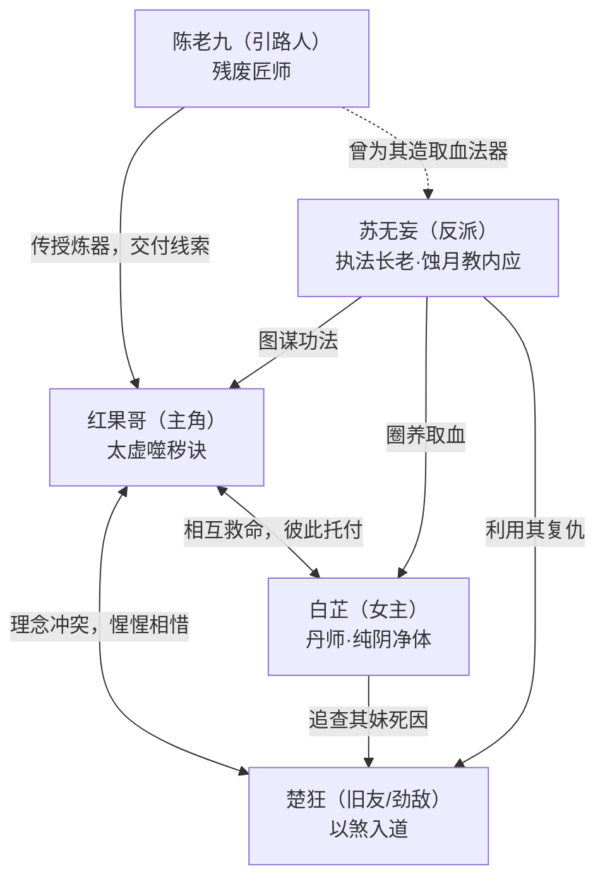

# 《末世修仙：道蚀纪元》世界观与四卷大纲

> 主角：**红果哥**（猎荒散修）
> 类型：末世 + 修仙 + 悬疑解谜
> 结构：四卷完结，每卷一个核心谜题、一次立场转变、一个不可逆的代价

---

## 一、故事内核

**一句话故事**：灵气带毒的末世里，拾荒散修红果哥靠一门"吞噬他人道毒"的功法往上爬，却发现人人续命所需的避毒丹，是拿活人炼的。

**核心矛盾**：不修行会死于秽兽，修行会死于道蚀；而唯一能让人活下去的东西，被少数人攥在手里。

**主题**：
- 表层——在绝境里，活下去本身就是一种道德选择。
- 深层——当"续命"必须建立在他人痛苦之上，是接受规则，还是砸碎规则？

**情绪曲线**：苟活（卷一）→ 愤怒（卷二）→ 分裂（卷三）→ 承担（卷四）。

**主角金手指的代价**：他每救一个人，就多背一份别人的记忆与执念。越强，越不像自己。

---

## 二、世界观设定

### 1. 灾变：道蚀之日

- **表层认知**：百年前天地灵气突然复苏，复苏的却是混杂混沌与恶意的**灵秽**（俗称煞雾）。
- **隐藏真相**（卷四揭晓）：上古修士清不掉灵秽，只能将它封入地脉深处。百年前封印破裂，灵秽倒灌人间。所谓"上古净土"，其实是封印尚未破裂的节点。
- **灾变后果**：
  - 凡人吸入灵秽，血脉突变、神智泯灭，沦为**秽兽**（兽类异化）与**畸变种**（人类异化）。
  - 工业文明在灵气风暴与电磁瘫痪中瓦解；常规热武器对灵力护体的高阶秽兽收效甚微。
  - 少数人在生死关头感应到古修遗泽，学会引气吐纳。百年间传承分化，形成宗门与散修。

### 2. 灵秽生态与秽兽分级

| 等级 | 特征 | 对应威胁 | 秽丹价值 |
| --- | --- | --- | --- |
| 浊兽 | 兽形初变，畏光 | 练气初期可猎 | 一枚换三日药 |
| 蚀兽 | 皮生异纹，成群 | 练气后期需结队 | 一枚换半月药 |
| 巢主 | 能驱使低阶秽兽 | 筑基修士的猎物 | 一枚换一年药 |
| 畸王 | 人形异种，保留道法 | 金丹级灾难 | 有价无市 |
| 源秽 | 灵秽本体凝结 | 传说 | 不可交易 |

**生态规则**：灵秽浓处秽兽强；秽兽死后秽丹可炼药；**清灵力是秽兽唯一惧怕的力量**——这是人类还能活着的根本原因。

### 3. 道蚀法则

修士吐纳灵气时，体内同步积累**道毒**。修为越深，道毒越重；心境失守或强催秘法会加速侵蚀。

| 阶段 | 外在征兆 | 后果 |
| --- | --- | --- |
| 微染 | 失眠、易怒 | 服避毒丹可压制 |
| 显征 | 皮肉生异纹，出现幻听 | 药量倍增，仙城拒绝入内 |
| 噬心 | 记忆混乱，敌我难辨 | 药石只能拖延 |
| 道堕 | 神智尽失，保留道法 | 化为凶残百倍的人形异种，不可逆 |

### 4. 避毒丹：全书的经济命脉

- **流通逻辑**：猎荒者猎杀秽兽取**秽丹** → 卖给仙城 → 换**避毒丹**。仙城垄断丹方与定价权。
- **硬通货**：避毒丹按"日份"计价，一枚成丹可压十日道毒。荒年药价翻三倍，等于直接判死一批散修。
- **秘密**：丹中缺不得的一味药引，是**净体者的血**。净体者天生能把灵秽中的毒性剥离，一生被抽血数次即枯。这是仙盟最大的秘密，也是卷二的核心转折。
- **反讽**：所有人吃的"救命药"，本质上是另一群人的命。

### 5. 境界体系

| 境界 | 能力 | 突破关口 | 道蚀风险 |
| --- | --- | --- | --- |
| 练气（清秽入脉） | 引气锻体，掌握法器与基础五行术法 | 淬出第一缕清灵力 | 积毒慢，丹药可控 |
| 筑基（道基奠定） | 开辟气海，御器 | 炼化一件**镇秽奇物**（如定尘珠）入道基 | 奇物品质决定日后抗蚀上限 |
| 金丹（九转凝丹） | 丹火、神识外放 | 凝丹分三品：凡丹、灵丹、无瑕玄丹 | 煞气过重则成**煞丹**，战力狂暴、寿元折损 |
| 元婴（神魂化婴） | 元神离体，借灵脉投影领域 | 过心魔劫，直面积攒的全部道毒 | 一城老祖级，一旦道堕即是灭城之灾 |
| 化神 / 合道 | 传说 | 勘破天道畸变的根源 | 未知 |

### 6. 主角功法：《太虚噬秽诀》

- **能力**：吞噬他人或秽兽体内的道毒，炼为自身灵力。
- **代价**：道毒只能压住，无法消除；吞下的毒带着原主的记忆与执念。吞得越多，红果哥越分不清哪些念头是自己的。
- **限制**：每突破一境，必须由净体者疏导一次，否则当场道堕。
- **来历**：上古修士为清理灵秽所创。修此诀者，本就是封印的"容器"。
- **叙事作用**：功法既是主角的上升通道，也是他的倒计时——每一卷都在问同一个问题：他还能不能认出自己？

### 7. 势力格局

| 势力 | 立场 | 内部矛盾 |
| --- | --- | --- |
| **仙盟**（各仙城要塞的联合体） | 守住净土，维持秩序；靠避毒丹控制外界 | 内城长老把持灵田，外城修士缺药 |
| ├ 青云仙坞 | 擅阵法与丹道，掌握丹方 | 部分丹师知情后良心难安 |
| └ 神兵城 | 机关傀儡术结合重工业 | 想用傀儡摆脱对丹药的依赖，与青云对立 |
| **猎荒团**（散修同盟） | 拾荒猎兽，以秽丹换药 | 各团为活命互相倾轧 |
| **蚀月教** | 认为畸变是天道演化的终极形态，主动纳煞求永生 | 清醒派与道堕派之争；暗中渗透仙盟 |

### 8. 地理与日常

- **荒原**：旧文明废墟带，煞雾最浓，秽兽密集，散修的猎场与坟场。
- **青云仙坞**：建于灵脉之上的丹道仙城，白墙高塔，内城灵田如镜，外城挤满等药的散修。
- **神兵城**：钢铁与符阵并存的工业要塞，昼夜轰鸣，傀儡巡街。
- **蚀月教据点**：藏于煞雾深处的"月蚀谷"，教徒以纳煞为修行，伤口会自己长回来。
- **地脉深处**：封印所在，全书终点。

**日常细节**（写作时可反复调用）：
- 入城要验"纹"——显征者不得入内，只能在外城药摊排队。
- 药价随秽兽潮涨落，猎荒团在药价公布日集体沉默。
- 散修死前会把剩下的药分给同伴，这叫"留一口"。

### 9. 世界硬规则（写作时必须遵守）

1. 道毒**不可消除**，只能压制、转移或封存。
2. 噬秽诀的每一次突破，都必须有净体者疏导，否则当场道堕。
3. 避毒丹必须有净体者血，没有例外——这是全书最大的道德炸弹。
4. 热武器对高阶秽兽基本无效，普通人只能靠符器与阵法自保。
5. 境界不是纯战力：金丹以上，道毒本身就是实力的一部分，越强越危险。
6. 秽兽不惧痛、不惧死，只惧清灵力与强光符阵。

---

## 三、主要人物

| 角色 | 身份 | 想要什么 | 软肋 / 秘密 | 人物弧光 |
| --- | --- | --- | --- | --- |
| **红果哥**（主角） | 猎荒散修，修《太虚噬秽诀》 | 起初只想给自己和同伴挣够药 | 信奉"先活下来"；记忆正被道毒侵占 | 从只顾自保，到愿意替众人承担道毒 |
| **白芷**（女主） | 青云仙坞丹师，纯阴净体，被奉为"避毒圣女" | 研制不需要人血的丹方 | 发现自己是被圈养的药引 | 从被供奉者变为掀翻丹药垄断的人 |
| **楚狂**（旧友 / 劲敌） | 以煞入道的狂剑客 | 向仙盟复仇 | 妹妹是净体者，死于取血；自己已近噬心 | 为复仇投向蚀月教，终局清醒赴死 |
| **陈老九**（引路人） | 金丹破碎的残废匠师 | 赎罪 | 曾为仙盟打造取血法器 | 交出证据，以死为红果哥开路 |
| **苏无妄**（反派） | 仙盟执法长老（元婴），暗通蚀月教 | 夺《噬秽诀》与净体，自成无瑕之身以求长生 | 本人已在道堕边缘 | 当年的救世派，如何一步步认定众生皆可为药 |

---

## 四、四卷大纲

### 卷一《荒原药价》——活下去

- **境界**：练气
- **核心问题**：为救一群人，能不能先骗过自己？
- **核心冲突**：断药 vs. 冒险接单；自保 vs. 救人

**分幕**：
1. **药价公布日**：猎荒团"三钉子"断药，红果哥算了一夜账，接下没人敢接的"废城深处"险单。
2. **废城**：队伍在煞雾中折损两人，红果哥在坍塌的道观里摸到《太虚噬秽诀》残卷，第一次吞下秽兽道毒——活下来了，但听见了死者的声音。
3. **结识陈老九**：废墟铁匠铺里，一个金丹破碎的老匠师替他修好破损法器，教他"毒不是敌人，是账"。楚狂因妹妹的事与队伍决裂离队。
4. **第一次吞毒救人**：同伴道堕在即，红果哥当众吞下他的毒，把人从噬心边缘拉回来，功法暴露。
5. **卷末**：猎荒团因断药全员濒临道堕，红果哥成了唯一能"续命"的人，也成了所有人眼里的东西——药、怪物、或者希望。

- **卷末钩子**：陈老九看着他的功法，说了一句："这功法，不该还在世上。"
- **人物变化**：红果哥从"算账的人"变成"被账追着走的人"。

---

### 卷二《仙城高墙》——墙里的人

- **境界**：练气 → 筑基
- **核心问题**：救命药是拿人炼的，你还要不要吃？
- **核心冲突**：仙城秩序 vs. 真相；白芷的信仰崩塌

**分幕**：
1. **入城**：红果哥带秽丹进青云仙坞换镇秽奇物，第一次见到"药"是怎么被生产出来的；外城药摊前，有人排了三天队，死在队里。
2. **白芷**：他被指给"避毒圣女"做护卫。白芷清冷、体弱、被供在塔顶，却在偷偷改良丹方——她以为自己在救人。
3. **苏无妄**：执法长老以庇护为名监视二人，赐药、赐宅、赐名分，步步收网。
4. **取血房**：白芷追踪药引来源，撞见取血法器与"净体者名册"；陈老九交出自己的旧图纸，证实丹方真相。
5. **卷末**：真相被压下，陈老九为掩护二人身死，红果哥带着白芷叛出仙城。

- **卷末钩子**：苏无妄站在城头，看着他们逃走，只说了一句："跑吧，外面更需要药。"
- **人物变化**：白芷从"被供奉者"变成"逃亡者"；红果哥第一次不是为了自己活而动手。

---

### 卷三《蚀月》——代价

- **境界**：筑基 → 金丹
- **核心问题**：揭开真相之后，谁替死掉的人负责？
- **核心冲突**：公开真相 vs. 秩序崩溃；与楚狂的立场对撞

**分幕**：
1. **逃亡**：二人被仙盟通缉，在荒原上靠红果哥吞毒换命，他的记忆开始出现别人的片段。
2. **月蚀谷**：被蚀月教"救"走。教主请他看"纳煞成道"的可能性——不靠丹药，也不用杀人。
3. **重逢楚狂**：楚狂已是教中利刃，妹妹死于取血，他要的不是真相，是烧掉整座仙城。
4. **公开真相**：白芷以圣女身份在仙城大典上公布丹方，仙城大乱；丹药断供，外界大批修士道堕。
5. **卷末**：红果哥第一次面对"我做的事害死了人"。他选择不回仙城，也不入蚀月教，而是往地脉去。

- **卷末钩子**：他从吞噬的记忆里，看到百年前封印破裂的那一夜。
- **人物变化**：从"复仇者/救世者"变成"承担后果的人"。

---

### 卷四《道蚀之源》——容器

- **境界**：金丹 → 元婴及以上
- **核心问题**：如果只有你能当容器，你当不当？
- **核心冲突**：封印 vs. 自我；苏无妄的"长生"与红果哥的"承担"

**分幕**：
1. **入地脉**：红果哥、白芷、楚狂残部深入封印，见到上古修士留下的"容器"遗骸——每一具都修过噬秽诀。
2. **苏无妄的真相**：他当年是主张"以人炼药救多数"的救世派，如今已在道堕边缘；他要夺功法与净体，把自己炼成无瑕之身。
3. **决战**：楚狂以煞丹之力拖住苏无妄，清醒赴死；白芷以新丹方稳住众人道毒，为红果哥争取时间。
4. **重封**：红果哥以身为容器重封灵秽，吞下整条地脉的毒，记忆几乎被别人的执念淹没。
5. **结局**：白芷的新丹方不再需要人血，仙城的垄断被打破；封印之上，红果哥保留一线神智归来（或开放式收尾，视最终取向）。

- **卷末钩子 / 余韵**：他回来时，已经不完全是"红果哥"了——但他记得自己答应过谁。
- **人物变化**：从"替众人承担道毒"，到"替众人成为道毒"。

---

## 五、伏笔与回收表

| 伏笔 | 埋设位置 | 回收位置 |
| --- | --- | --- |
| 陈老九打造的取血法器 | 卷一（修法器时提到"老手艺"） | 卷二（图纸与名册） |
| 楚狂的妹妹 | 卷一（离队原因含糊） | 卷三（净体者名册上的名字） |
| 苏无妄"已在道堕边缘" | 卷二（他偶尔听不见别人说话） | 卷四（决战时的道堕征兆） |
| "上古净土"是封印节点 | 卷一（老人口中的传说） | 卷四（地脉真相） |
| 白芷的净体身份 | 卷二（她从小被"供奉"） | 卷三（圣女大典公开） |
| 红果哥听见别人的声音 | 卷一（第一次吞毒后） | 卷四（容器遗骸的解释） |

---

## 六、写作参数与待定问题

**篇幅建议**：四卷 × 约 40–50 章，单章 2500–3500 字，总计约 60–80 万字。

1. 结局取向：红果哥是长眠于封印、保留神智归来，还是开放式收尾？
2. 白芷与红果哥的感情线占比多大？（建议不超过三成，作为"人性锚点"而非主线）
3. 灾变前的现代遗物与知识在剧情中起多大作用？神兵城可作切入口。
4. 每卷是否需要独立的小反派，还是全程只追苏无妄一条线？
