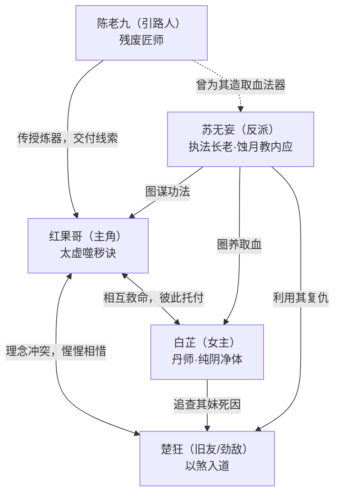

# 《末世修仙：道蚀纪元》设定大纲

**一句话故事**：灵气带毒的末世里，拾荒散修红果哥靠一门“吞噬他人道毒”的功法往上爬，却发现人人续命所需的避毒丹，是拿活人炼的。

**核心矛盾**：不修行会死于秽兽，修行会死于道蚀；能让人活下去的办法，被少数人攥在手里。

---

## 一、世界观设定

### 1. 灾变起因：道蚀之日

- **表层认知**：百年前天地灵气突然复苏，复苏的却是混杂混沌与恶意的**灵秽**（煞雾）。
- **隐藏真相**（卷四揭晓）：上古修士清不掉灵秽，只能将它封入地脉深处。百年前封印破裂，灵秽倒灌人间。所谓“上古净土”，是封印尚未破裂的节点。
- **灾变后果**：
  - 凡人吸入灵秽，血脉突变、神智泯灭，沦为**秽兽**（兽类异化）与**畸变种**（人类异化）。
  - 工业文明在灵气风暴与电磁瘫痪中瓦解，常规热武器对灵力护体的高阶秽兽收效甚微。
  - 少数人在生死关头感应到古修遗泽，学会引气吐纳。百年间传承分化，形成如今的宗门与散修。

### 2. 道蚀法则

修士吐纳灵气时，体内同步积累**道毒**。修为越深，道毒越重；心境失守或强催秘法会加速侵蚀。

| 阶段 | 外在征兆 | 后果 |
| --- | --- | --- |
| 微染 | 失眠、易怒 | 服避毒丹可压制 |
| 显征 | 皮肉生异纹，出现幻听 | 药量倍增，仙城拒绝入内 |
| 噬心 | 记忆混乱，敌我难辨 | 药石只能拖延 |
| 道堕 | 神智尽失，保留道法 | 化为凶残百倍的人形异种，不可逆 |

**避毒丹**是全书的硬通货：猎荒者猎杀秽兽取**秽丹**，卖给仙城换避毒丹。仙城垄断丹方。丹中缺不得的一味药引，是**净体者的血**，这是仙盟最大的秘密。

### 3. 境界划分

| 境界 | 能力 | 突破关口 | 道蚀风险 |
| --- | --- | --- | --- |
| 练气（清秽入脉） | 引气锻体，掌握法器与基础五行术法 | 淬出第一缕清灵力 | 积毒慢，丹药可控 |
| 筑基（道基奠定） | 开辟气海，御器 | 炼化一件**镇秽奇物**（如定尘珠）入道基 | 奇物品质决定日后抗蚀上限 |
| 金丹（九转凝丹） | 丹火、神识外放 | 凝丹分三品：凡丹、灵丹、无瑕玄丹 | 煞气过重则成**煞丹**，战力狂暴、寿元折损 |
| 元婴（神魂化婴） | 元神离体，借灵脉投影领域 | 过心魔劫，直面积攒的全部道毒 | 一城老祖级，一旦道堕即是灭城之灾 |
| 化神 / 合道 | 传说 | 勘破天道畸变的根源 | 未知 |

### 4. 主角功法：《太虚噬秽诀》

- **能力**：吞噬他人或秽兽体内的道毒，炼为自身灵力。
- **代价**：道毒只能压住，无法消除；吞下的毒带着原主的记忆与执念。吞得越多，红果哥越分不清哪些念头是自己的。
- **限制**：每突破一境，必须由净体者疏导一次，否则当场道堕。
- **来历**：上古修士为清理灵秽所创。修此诀者本是封印的“容器”。

### 5. 势力格局

| 势力 | 立场 | 内部矛盾 |
| --- | --- | --- |
| **仙盟**（各仙城要塞的联合体） | 守住净土，维持秩序；靠避毒丹控制外界 | 内城长老把持灵田，外城修士缺药 |
| ├ 青云仙坞 | 擅阵法与丹道，掌握丹方 | 部分丹师知情后良心难安 |
| └ 神兵城 | 机关傀儡术结合重工业 | 想用傀儡摆脱对丹药的依赖，与青云对立 |
| **猎荒团**（散修同盟） | 拾荒猎兽，以秽丹换药 | 各团为活命互相倾轧 |
| **蚀月教** | 认为畸变是天道演化的终极形态，主动纳煞求永生 | 清醒派与道堕派之争；暗中渗透仙盟 |

---

## 二、角色设定与人物关系

| 角色 | 身份 | 想要什么 | 软肋 / 秘密 | 人物弧光 |
| --- | --- | --- | --- | --- |
| **红果哥**（主角） | 猎荒散修，修《太虚噬秽诀》 | 起初只想给自己和同伴挣够药 | 信奉“先活下来”；记忆正被道毒侵占 | 从只顾自保，到愿意替众人承担道毒 |
| **白芷**（女主） | 青云仙坞丹师，纯阴净体，被奉为“避毒圣女” | 研制不需要人血的丹方 | 发现自己是被圈养的药引 | 从被供奉者变为掀翻丹药垄断的人 |
| **楚狂**（旧友 / 劲敌） | 以煞入道的狂剑客 | 向仙盟复仇 | 妹妹是净体者，死于取血；自己已近噬心 | 为复仇投向蚀月教，终局清醒赴死 |
| **陈老九**（引路人） | 金丹破碎的残废匠师 | 赎罪 | 曾为仙盟打造取血法器 | 交出证据，以死为红果哥开路 |
| **苏无妄**（反派） | 仙盟执法长老（元婴），暗通蚀月教 | 夺《噬秽诀》与净体，自成无瑕之身以求长生 | 本人已在道堕边缘 | 当年的救世派，如何一步步认定众生皆可为药 |

---

## 三、主线剧情

| 分卷 | 境界 | 主要事件 | 卷末转折 |
| --- | --- | --- | --- |
| 卷一《荒原药价》 | 练气 | 红果哥为救同伴接下险单，在废墟中得《噬秽诀》，结识陈老九；楚狂离队 | 猎荒团因断药全员濒临道堕，红果哥第一次吞毒救人，暴露功法 |
| 卷二《仙城高墙》 | 筑基 | 红果哥入青云仙坞换取镇秽奇物，与白芷合作；苏无妄以庇护为名监视 | 两人发现避毒丹药引的真相，陈老九身死，红果哥叛出仙城 |
| 卷三《蚀月》 | 金丹 | 逃亡中与蚀月教周旋，重逢楚狂；公开真相引发仙城内乱 | 丹药断供，外界大批修士道堕；红果哥要为自己揭开真相的后果负责 |
| 卷四《道蚀之源》 | 元婴及以上 | 深入地脉查明封印真相，决战苏无妄 | 红果哥以身为容器重封灵秽，白芷以新丹方为他、也为世人留一条生路 |

---

## 四、待定问题

1. 结局取向：红果哥是长眠于封印、保留神智归来，还是开放式收尾？
2. 白芷与红果哥的感情线占比多大？
3. 灾变前的现代遗物与知识在剧情中起多大作用？神兵城可作切入口。
4. 目标篇幅与每卷字数。
